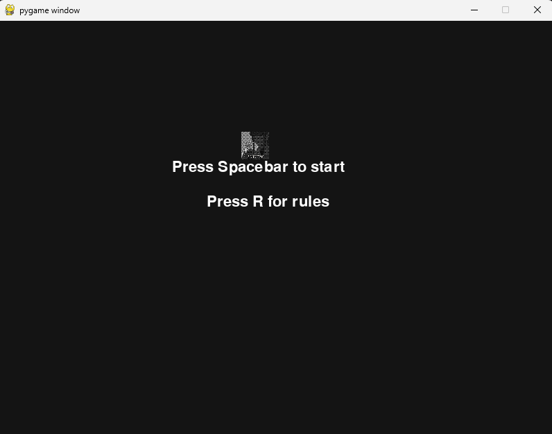
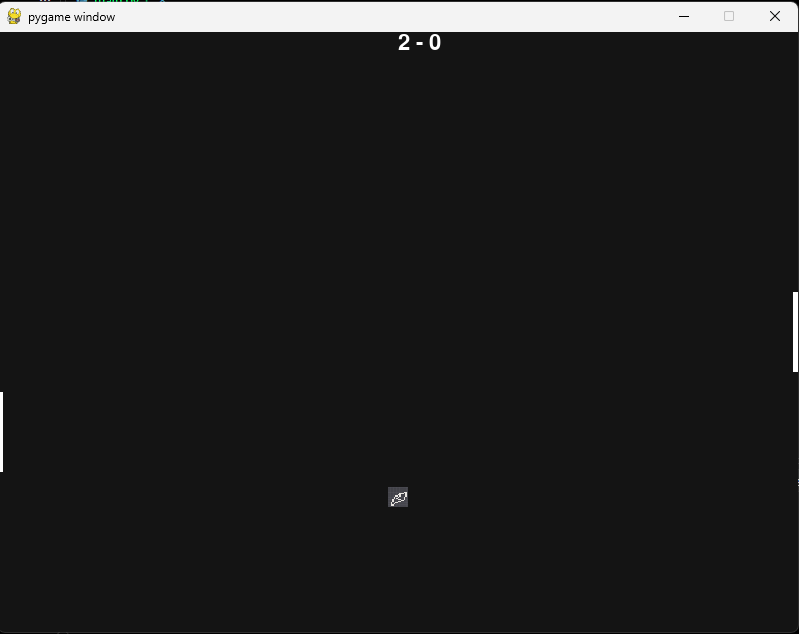
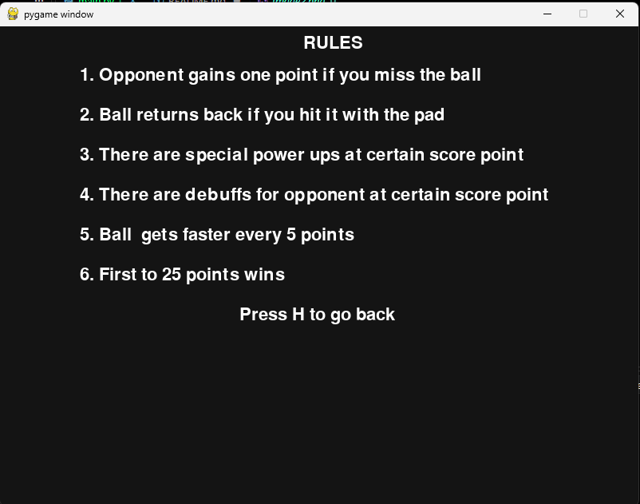
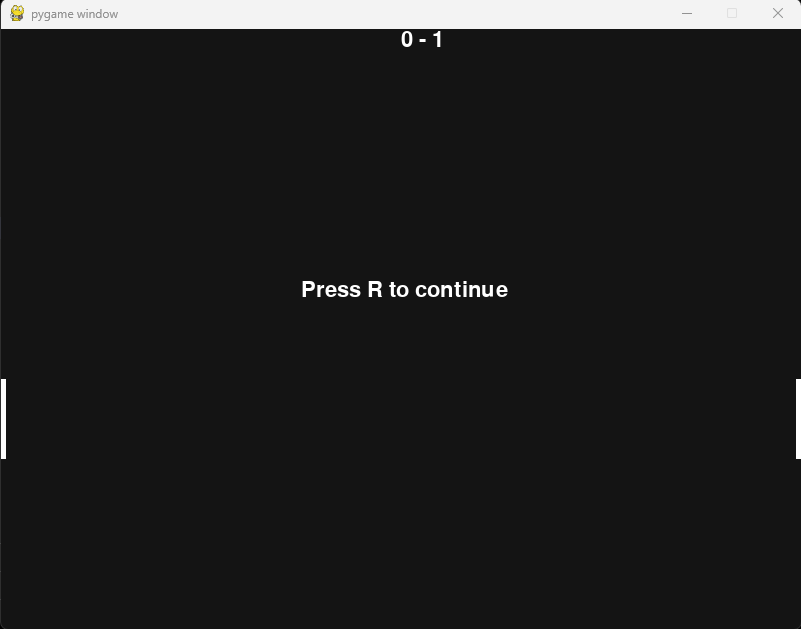

# pongle
My second pygamw project . Pong but there's power ups every few points

Pygbag was used to make it web accessible which adds new files other than main.py, you can ignore those :)

Tools used:
>Pygame
>Pygbag to make it web playable

Access:
>https://shimes.itch.io/pongle

Why i built it:
>To learn pygame and make a "fun" game if you can call it that

AI USAGE:
>Making it itch.io workable/pygbag format
>Google overview for syntaxes
>Finding bug sometimes
>Check before submission to ensure it works

PROBLEM I FACED:
>I used too many loops making it hard to debug at times instead of just using arrays or function which would have made the code simpler and easier to debug

SCREENSHOTS

It's a basic pong game with some powerups , dont think I need to add much to this readme, enjoy :)
